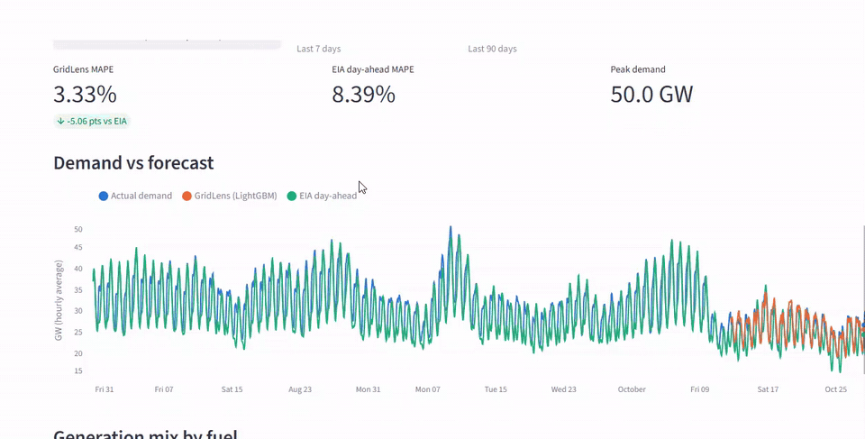
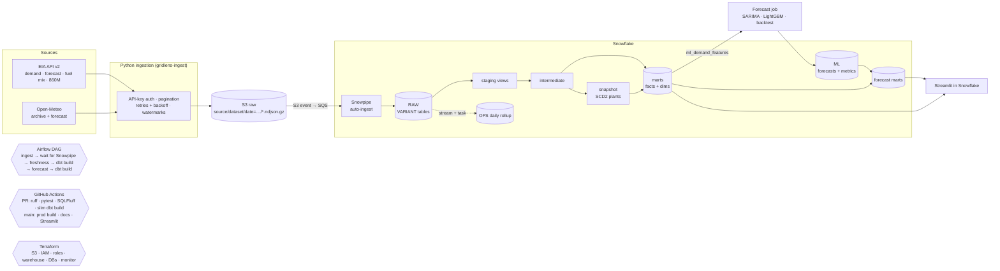
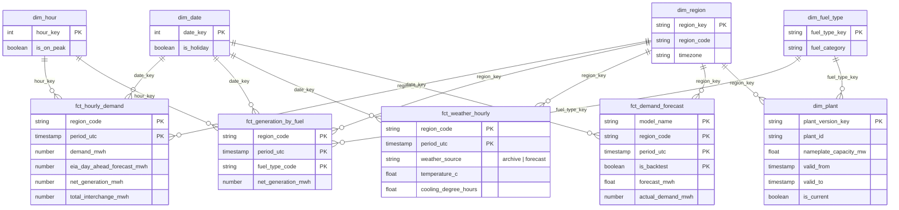
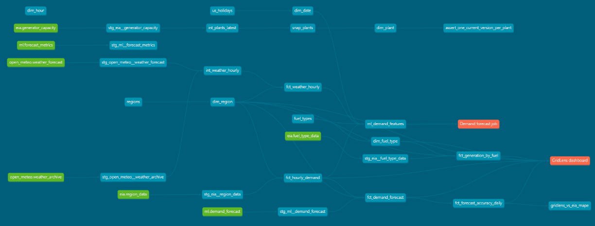

# GridLens

**End-to-end analytics platform on public US power-grid data.** Hourly electricity demand,
generation by fuel and weather for eight US grid regions are ingested from public APIs, landed in
S3, auto-loaded into Snowflake, modeled as a Kimball star schema with dbt, orchestrated in Airflow,
and used to forecast next-day demand. The forecasts are scored against EIA's own published forecast.


| | |
|---|---|
| **Sources** | EIA API v2 (hourly demand, day-ahead forecast, generation by fuel; EIA-860M plant inventory) · Open-Meteo (hourly weather) |
| **Stack** | Python · S3 · Snowpipe · Snowflake · dbt · Airflow (Astro + Cosmos) · LightGBM / SARIMA · Streamlit in Snowflake · GitHub Actions · Terraform |
| **Regions** | CISO, ERCOT, PJM, MISO, NYISO, ISO-NE, SPP, FPL ([`regions.csv`](dbt/seeds/regions.csv)) |

> **Headline result** *(fill in after the first 30 days of live forecasts; the query is
> [`analyses/gridlens_vs_eia_mape.sql`](dbt/analyses/gridlens_vs_eia_mape.sql))*: next-day hourly
> demand MAPE of **X.X%** for GridLens LightGBM vs **Y.Y%** for EIA's day-ahead forecast and
> **Z.Z%** for the SARIMA baseline, over the same hours.



---

## Architecture



## Data model

Grain is **region × UTC hour** for every hourly fact. Local time, local date and local hour are
derived per region from `dim_region.timezone`, so "5 pm peak" means 5 pm in that region and DST
is handled correctly.



Plus `fct_forecast_accuracy_daily` (model × region × day MAPE, with EIA scored on the same hours)
and `ml_demand_features` (the feature table the forecast job reads).

### Lineage



---

## Repository layout

```
src/gridlens/
  ingest/      EIA + Open-Meteo clients, retrying HTTP, idempotent pipelines, S3/local storage, Snowpipe wait
  forecast/    features, models (seasonal naive, SARIMA, LightGBM), rolling-origin backtest, Snowflake I/O
  common/      config, key-value logging, Snowflake key-pair connection, Slack failure alerts
dbt/           staging → intermediate → marts, snapshot, seeds, macros, tests, exposures
snowflake/     RAW stage/tables/pipes; ML tables; stream + task; dashboard schema
airflow/       Astro project: DAG (Cosmos), Dockerfile
dashboard/     Streamlit in Snowflake app + Snowflake CLI project
terraform/     S3, IAM, storage integration, roles, warehouse, databases, resource monitor
.github/       CI (lint, tests, slim dbt build), CI schema cleanup, prod deploy
tests/         pytest: HTTP retries, pagination, idempotency, watermarks, features, backtest, alerts
```

---

## How to run it

### 0. Prerequisites

Python 3.10+, a free [EIA API key](https://www.eia.gov/opendata/register.php), a Snowflake account
(a trial works), and for the cloud path an AWS account, Terraform ≥ 1.6, the
[Snowflake CLI](https://docs.snowflake.com/en/developer-guide/snowflake-cli/index) and the
[Astro CLI](https://www.astronomer.io/docs/astro/cli/install-cli).

```bash
python -m venv .venv && source .venv/bin/activate   # Windows: .venv\Scripts\activate
pip install -e ".[dev,ingest,forecast,dashboard]"
cp .env.example .env                                # fill in EIA_API_KEY at minimum
pytest                                              # 31 tests, no network or warehouse needed
```

### 1. Ingest locally (no cloud needed)

```bash
gridlens-ingest all --start 2025-01-01 --end 2025-01-07   # writes ./data/raw/...
gridlens-ingest all                                       # incremental: watermark - lookback .. today
```

Re-running a day rewrites byte-identical files; the watermark only advances past days that returned data.

### 2. Provision infrastructure (Terraform)

```bash
# Key pair for the service user
openssl genrsa 2048 | openssl pkcs8 -topk8 -inform PEM -out rsa_key.p8 -nocrypt
openssl rsa -in rsa_key.p8 -pubout -out rsa_key.pub

cd terraform
cp terraform.tfvars.example terraform.tfvars          # fill in
terraform init && terraform apply
```

Creates the S3 bucket, the IAM role Snowflake assumes, the storage integration, the `RAW` /
`ANALYTICS` / `DEV` databases, the `LOADER` / `TRANSFORMER` / `REPORTER` roles with grants, an
XS warehouse (60 s auto-suspend), a monthly resource monitor, and the `GRIDLENS_SVC` key-pair user.

### 3. Create the RAW landing layer and Snowpipes

```bash
snow sql -f snowflake/01_raw_landing.sql --role LOADER               # schemas, internal stage, raw tables
snow sql -f snowflake/01b_s3_snowpipe.sql -D "bucket=<your-bucket>" --role LOADER   # S3 stage + pipes
snow sql -q "show pipes in database RAW" --role LOADER     # copy notification_channel
# set snowpipe_sqs_arn in terraform.tfvars, then:
terraform -chdir=terraform apply                           # wires S3 → SQS → Snowpipe
snow sql -f snowflake/02_analytics_objects.sql --role TRANSFORMER   # ML tables, stream + task
```

From now on `GRIDLENS_STORAGE=s3 gridlens-ingest all` lands files that Snowflake loads within
about a minute. *No AWS?* Keep local mode and run `python scripts/load_local_to_snowflake.py`
instead; it PUTs to an internal stage and runs the same COPY.

### 4. Build the warehouse (dbt)

```bash
cd dbt
dbt deps
dbt build                       # dev target → DEV.DBT_<you>_*; seeds, snapshot, models, 80+ tests
dbt source freshness
dbt docs generate && dbt docs serve   # lineage graph (screenshot → docs/img/lineage.png)
```

### 5. Forecast

```bash
gridlens-forecast --dry-run --backtest-days 14   # prints MAPE per model, writes nothing
gridlens-forecast                                # writes ANALYTICS.ML.*
cd dbt && dbt build --select tag:forecast_output --target prod
```

### 6. Orchestrate (Airflow)

```bash
python scripts/sync_airflow_include.py   # copies the package + dbt project into airflow/include
cd airflow && cp .env.example .env       # fill in; put rsa_key.p8 in airflow/include/
astro dev start                          # http://localhost:8080 → gridlens_daily
```

The DAG runs daily at 06:30 UTC: `ingest` (one mapped task per dataset) → `wait_for_snowpipe` →
`dbt_source_freshness` → `dbt_core` (Cosmos renders one task per model and test) → `forecast` →
`dbt_forecast`. Any failure posts to Slack.

### 7. Dashboard

```bash
cd dashboard && snow streamlit deploy --replace --role TRANSFORMER
snow sql -q "grant usage on streamlit ANALYTICS.APPS.GRIDLENS_DASHBOARD to role REPORTER"
# or locally:  streamlit run dashboard/streamlit_app.py
```

### 8. CI/CD

Add repository secrets `SNOWFLAKE_ACCOUNT`, `SNOWFLAKE_USER`, `SNOWFLAKE_PRIVATE_KEY` (PEM) and
`SNOWFLAKE_PRIVATE_KEY_PASSPHRASE`. Optional repository variables `PUBLISH_DOCS=true` (dbt docs on
GitHub Pages) and `DEPLOY_STREAMLIT=true`.

| Trigger | What runs |
|---|---|
| Pull request | `ruff` + `pytest` · `sqlfluff lint` · **slim CI**: `dbt build --select state:modified+ --defer` against the last prod manifest, into `DEV.CI_PR_<n>_*` |
| PR closed | drop the PR's CI schemas |
| Merge to `main` | `dbt build --target prod` · upload manifest (for slim CI) · dbt docs · Streamlit deploy |

---

## Design decisions

**Idempotent ingestion, in two layers.** Each (dataset, day) maps to exactly one S3 key, and the
gzip bytes are deterministic (sorted rows, `mtime=0`). A re-run overwrites the same object with the
same bytes, so the ETag doesn't change and Snowpipe skips it. If EIA revised the data, the bytes
differ and Snowpipe loads the new version, and staging keeps only the latest-loaded row per natural
key. Ingestion re-pulls a 3-day lookback behind the watermark because EIA revises recent hours.

**Why each model is (or isn't) incremental.**

| Model | Materialization | Why |
|---|---|---|
| `fct_hourly_demand` | incremental merge | Largest table, mostly append-only. The source is *long* (one row per series type) and the fact is *wide*, so it finds the (region, hour) keys that got **any** new row and rebuilds those keys completely. Merging only the new rows would overwrite demand with NULL when only the forecast was revised. |
| `fct_generation_by_fuel` | incremental merge | Same size class, and the source is already at the fact's grain, so a plain `loaded_at` filter is correct. |
| `fct_weather_hourly` | incremental merge | A row starts as a forecast and is later replaced by reanalysis. Both arrive with a newer `loaded_at`, so the merge picks the change up without a full refresh. |
| staging | views | Cheap to keep current, and the de-duplication logic lives in one place. |
| dims, forecast marts | tables | Small; a full rebuild is simpler than incremental logic. |

**Why `dim_plant` is SCD Type 2.** EIA-860M is a monthly inventory: plants are uprated, repowered
(coal → gas), change operator, and retire. Analyses like "capacity by fuel in each region *as of*
2024-06" need the attributes that were true then, not today's. A dbt snapshot with the `check`
strategy on the tracked attributes opens a new version when any of them change, and
`hard_deletes: invalidate` end-dates plants that drop out of the inventory. A singular test asserts
there is at most one current version per plant and no overlapping versions.

**One conformed fuel dimension.** EIA-860 uses detailed fuel codes (BIT, SUB, DFO…) while EIA-930
hourly data uses broad ones (COL, OIL…). A macro maps 860 to 930 codes, so plants and hourly
generation share `dim_fuel_type`.

**Time zones.** Everything is stored in UTC. Local time comes from each region's IANA zone, via the
`utc_to_local` macro, so DST shifts don't duplicate or drop hours.

**Forecast design.**
- The forecast is issued at the end of the last complete UTC day and covers all 24 hours of the next day.
- Every lag is at least 24 h (24, 48, 168, 336 h plus rolling means of the 24 h lag). This makes it a *direct* model: no recursive forecasting, and no feature can see the target day. A unit test asserts this.
- LightGBM is one global model across regions, with region as a categorical feature. It trains on **log demand**, so a 1% miss costs the same in PJM as in NYISO.
- SARIMA(2,0,1)(1,1,1)[24] on a 28-day window is the classical baseline. Seasonal naive (same hour last week) is the floor any model has to beat.
- Backtesting is rolling-origin: each of the last 14 days is re-forecast using only earlier data. EIA's day-ahead forecast is scored on **exactly the same hours**.
- **Known caveat:** backtest days use *observed* weather, while live forecasts use *forecast* weather. Backtest MAPE is therefore an optimistic upper bound on skill. Live rows (`is_backtest = false`) are the honest comparison, and the dashboard prefers them.

**Testing strategy.** About 80 dbt tests cover primary keys, relationships to every dimension,
accepted values, ranges, source freshness, SCD2 integrity, and a custom generic test,
`sums_to_parent`. It checks that hourly generation by fuel adds up to the reported net generation
within 2%. It warns on a few hours and errors when the gap looks systematic, because EIA publishes
the two series separately. Tests on the big facts only scan the last 10 days. The Python side has
31 unit tests covering retries, pagination, idempotency, watermarks, leak-free features, backtest
behavior, Snowpipe waiting and alerts.

**Cost.**
- One X-Small warehouse (1 credit/hour while running) with 60-second auto-suspend, shared by every workload.
- A resource monitor notifies at 50/75/90% of a monthly quota and suspends the warehouse at 100%.
- Snowpipe is serverless and bills per file. Daily partitions keep the file count around 5 files/day.
- Time Travel is 0 days on `RAW` and `DEV` (the raw files are in S3 anyway) and 1 day on `ANALYTICS`.
- Incremental facts and date-bounded tests keep daily runs short.
- The stream + task only runs when the stream has data (`SYSTEM$STREAM_HAS_DATA`).
- An S3 lifecycle policy tiers raw files down to IA and then Glacier IR.
- Streamlit in Snowflake adds no license cost.
- *Estimate:* the daily DAG keeps the warehouse busy for well under 15 minutes, so a few credits a month.

**RBAC.**
- `LOADER` owns RAW and nothing else.
- `TRANSFORMER` reads RAW and owns ANALYTICS (prod) and DEV (dev and per-PR CI schemas).
- `REPORTER` gets read-only access through future grants.
- Only Terraform uses `ACCOUNTADMIN`. Service auth is key-pair only.

**Why a stream + task when dbt exists?** It keeps `ANALYTICS.OPS.DAILY_DEMAND_ROLLUP` fresh hourly
between daily dbt runs, at near-zero cost. It recomputes only the (region, day) pairs touched by new
rows, from de-duplicated raw data, so EIA revisions flow through.

---

## Resume bullets

- Built an end-to-end analytics platform on public US grid data: Python API ingestion (auth,
  pagination, retries, idempotent re-runs) to S3, Snowpipe into Snowflake, and dbt Kimball marts
  (SCD2 snapshot, incremental merges, 80+ tests incl. a custom reconciliation test, docs,
  exposures), orchestrated in Airflow (Cosmos) with GitHub Actions slim CI/CD and Terraform-managed
  RBAC, warehouse and resource monitors.
- Built next-day hourly demand forecasts (SARIMA baseline, global LightGBM with weather and calendar
  features) with rolling-origin backtesting, reaching X% MAPE vs Y% for EIA's published day-ahead
  forecast on the same hours, and published them to a Streamlit-in-Snowflake dashboard.

## Data & licensing

U.S. Energy Information Administration data is public domain. Open-Meteo data is CC BY 4.0
([open-meteo.com](https://open-meteo.com/)). This project uses only public data.
